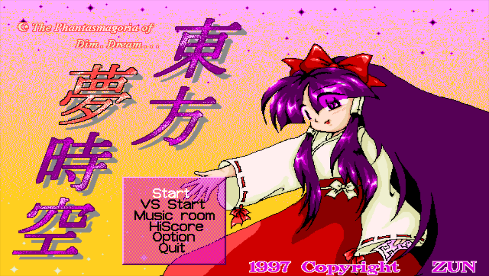
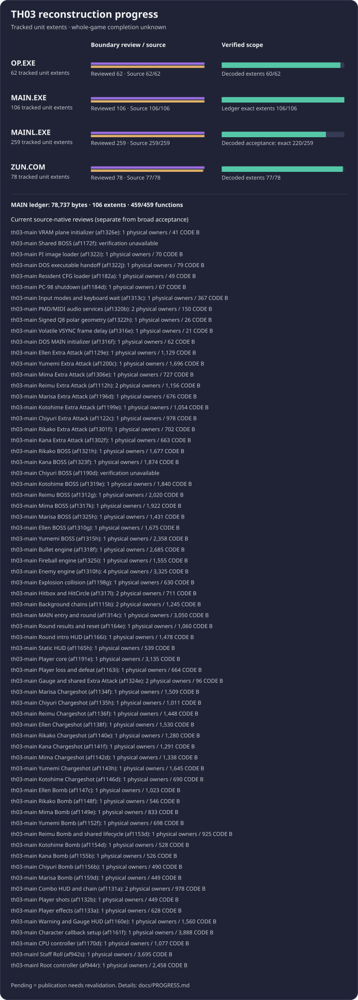

# 東方夢時空 ～ Phantasmagoria of Dim.Dream

A reconstruction of the Japanese PC-98 **Touhou 3: Phantasmagoria of Dim.Dream**,
with a native C++17 port for Windows and Linux. The portable version runs
without a DOS emulator and uses the original game's external data.

> [!NOTE]
> The native development preview supports story, versus CPU and two-player
> battles, endings, Staff Roll, Music Room, saves and PMD sound.
> Portable source is on [`port/modern-64`](https://github.com/N0zoM1z0/th03/tree/port/modern-64);
> the PC-98 DOS reconstruction is on [`main`](https://github.com/N0zoM1z0/th03/tree/main).
> Build instructions and the supported game-data layout are below.

<p align="center">
  
</p>
<p align="center">
  
</p>

## Play on Windows

### 1. Get a Windows x64 build

The portable version is currently a source-build preview; a public GitHub
Release has not been published. Follow [Build the portable version](#build-the-portable-version)
to build `th03-port64.exe` and copy the launchers into a writable play folder,
such as `C:\Games\th03-portable`.

The [portable guide](https://github.com/N0zoM1z0/th03/blob/port/modern-64/docs/PORTABLE.md)
records the current preview, verification and remaining gameplay checks.

### 2. Add your original game data

Place these files beside `th03-port64.exe`:

| File | Purpose |
| --- | --- |
| `th03.hdi` | Your supported Japanese full-version PC-98 hard-disk image, with the installed game in `YUMEZIKU`. |
| `FREECG98.BMP` | External 2048×2048 Anex86-format PC-98 font bitmap, also used by DOSBox-X. |
| `ym2608_adpcm_rom.bin` | External 8,192-byte YM2608 rhythm data for PMD86 sound. |

The HDI reader currently expects a specific FAT12 layout and reads the original
resource archives, `YUME.CFG` and `YUME.NEM` from `YUMEZIKU`. See
[supported original data](https://github.com/N0zoM1z0/th03/blob/port/modern-64/docs/PORTABLE.md#original-game-data)
for the format requirements. TH03 does not yet have TH04's loose-file preparation
script. Game files, the font and rhythm data are supplied separately.

### 3. Start the game

Run **Play.bat** for normal play with PMD86 sound, or **Play-silent.bat**
without sound or a rhythm ROM. Both keep scores and settings in `save-normal`
beside the executable. Keep this folder when updating; the game disk is read-only.

The optional
[Play-invincible.bat](https://github.com/N0zoM1z0/th03/blob/port/modern-64/port64/Play-invincible.bat)
protects human players while CPU players can still take damage. It patches a
new process in memory and uses separate `save-invincible` saves. This launcher
checks the supported preview executable's hash; use `Play.bat` for self-built
executables until their patch location is verified.

The title initially hides its menu: press a direction to reveal it.
Release keys between menu choices.

| Mode | Controls |
| --- | --- |
| Menus / single player | Arrow keys move or navigate; Z/Enter confirms, Z shoots, X bombs and Esc pauses or returns. |
| Two-player P1 | T/F/H/B move up/left/right/down; Z shoots and X bombs. |
| Two-player P2 | Numeric keypad moves; Left shoots and Right bombs. |
| Paused battle | Q returns to the title. |

See the [portable guide](https://github.com/N0zoM1z0/th03/blob/port/modern-64/docs/PORTABLE.md)
for Music Room, name entry, replay inputs and audio options.

## Build the portable version

Compiling requires CMake 3.16+, a 64-bit C++17 compiler and Ninja.
Linux also needs SDL2 and pkg-config. Original game data is needed at runtime.
Get the portable branch explicitly:

```sh
git clone --branch port/modern-64 https://github.com/N0zoM1z0/th03.git th03-portable
cd th03-portable
```

### Windows x64

Install MinGW-w64 GCC, CMake and Ninja. For
[MSYS2's UCRT64 environment](https://www.msys2.org/docs/environments/),
install the [GCC](https://packages.msys2.org/packages/mingw-w64-ucrt-x86_64-gcc),
[CMake](https://packages.msys2.org/packages/mingw-w64-ucrt-x86_64-cmake) and
[Ninja](https://packages.msys2.org/packages/mingw-w64-ucrt-x86_64-ninja) packages
in its **UCRT64** terminal:

```sh
pacman -S --needed mingw-w64-ucrt-x86_64-gcc mingw-w64-ucrt-x86_64-cmake mingw-w64-ucrt-x86_64-ninja
```

Then open **CMD**, enter your checkout and run the following. Adjust the
MSYS2 path if installed elsewhere:

```bat
set "PATH=C:\msys64\ucrt64\bin;%PATH%"
port64\build-windows.bat
mkdir run
copy build\portable-win64\th03-port64.exe run\
copy port64\Play.bat run\
copy port64\Play-silent.bat run\
```

Add the original data files to `run` as described above, then start
`run\Play.bat` or `run\Play-silent.bat`.

### Linux x86-64

On Debian/Ubuntu, install the build dependencies:

```sh
sudo apt install build-essential cmake ninja-build pkg-config libsdl2-dev
```

From the portable checkout, build the game and create a writable play folder:

```sh
cmake -S port64 -B build/linux-x64 -G Ninja -DCMAKE_BUILD_TYPE=Release
cmake --build build/linux-x64 --target th03-port64 --parallel 1
mkdir -p run
```

Place your `th03.hdi`, `FREECG98.BMP` and rhythm ROM in `run`, then launch:

```sh
./build/linux-x64/th03-port64 --hdi run/th03.hdi --font-bmp run/FREECG98.BMP \
  --save-dir run/save-normal --audio --pmd-driver pmd86 \
  --opna-rom run/ym2608_adpcm_rom.bin
```

For silent play, omit `--audio`, `--pmd-driver` and `--opna-rom`, and add `--mute`.
[Build details, headless checks and Linux-to-Windows cross-compilation](https://github.com/N0zoM1z0/th03/blob/port/modern-64/docs/PORTABLE.md#build-and-inspect)
are in the portable guide.

## Contribute

This reconstruction was built with AI coding agents. Contributions that improve
behavior, recovered semantics, readability and platform support are welcome.

- **Testing and bug reports.** Try different characters, difficulties, story
  routes, versus modes, endings, sound options and save flows. A recorded Reimu
  Easy campaign completes on both platforms, but broader manual play and
  listening remain useful. [Report bugs](https://github.com/N0zoM1z0/th03/issues/new)
  with your preview or commit, OS, reproduction steps and expected versus actual
  behavior. Screenshots or replays help with rendering issues.
- **Ports and backends.** Improve rendering, audio and input support, or help
  bring the portable version to additional platforms and architectures.
- **Semantics and readable source.** Review behavior against the original game,
  improve names and types, simplify control flow and document useful findings.
  Focused fixes with a reproduction or relevant comparison are welcome.

Send portable PRs to `port/modern-64` and DOS reconstruction PRs to `main`.

## Development

The current DOS composition reproduces `OP.EXE`, `MAIN.EXE`, `MAINL.EXE`
(the ending) and `ZUN.COM` byte for byte against the pinned Japanese targets.
The progress graphic describes tracked reconstruction scopes; it is not a
whole-game completion percentage. Native playability and source-exact DOS
acceptance are tracked separately.

- [DOS build composition and exact comparisons](docs/CURRENT_LINKED_BUILD_REVIEW.md)
- [Playing the rebuilt DOS game](docs/RUNTIME.md)
- [Reconstruction progress](docs/PROGRESS.md) and [current agent handoff](docs/RE_HANDOFF.md)
- [Source and build architecture](docs/ARCHITECTURE.md)
- [Reconstruction workflow](docs/RE_WORKFLOW.md), [shared tools](docs/SHARED_TOOLS.md) and [agent instructions](AGENTS.md)
- [Portable implementation, checks and remaining work](https://github.com/N0zoM1z0/th03/blob/port/modern-64/docs/PORTABLE.md)

## Credits

**ZUN** ([上海アリス幻樂団 / Team Shanghai Alice](https://www16.big.or.jp/~zun/))
created Touhou Project and the original TH03 game, characters, artwork and music.

Thanks to the authors and contributors of:

- **[ReC98](https://github.com/nmlgc/ReC98)** — **nmlgc and contributors**, for
  PC-98 reverse engineering, recovered source, hardware definitions and DOS
  build infrastructure used throughout this reconstruction.
- **[master.lib](https://github.com/nmlgc/ReC98/tree/master/libs/master.lib)** —
  the original PC-98 graphics and system library used by TH03.
- **[Our TH04 reconstruction](https://github.com/N0zoM1z0/th04)** — the reference
  for the portable workflow and the shared PMD synthesis, audio transport and
  host-timing work adapted for TH03.
- **KAJA / PMD** — the original PC-98 music driver and formats reconstructed
  by the portable audio layer.
- **[ymfm](https://github.com/aaronsgiles/ymfm)** — **Aaron Giles and contributors**,
  for Yamaha FM, SSG and ADPCM synthesis.
- **[SDL2](https://wiki.libsdl.org/SDL2/FrontPage)** — Linux windowing, input and audio.
- **[DOSBox-X](https://github.com/joncampbell123/dosbox-x)** and the
  **FREECG98 contributors** — PC-98 execution tests and the external font bitmap.
- **[libOPNMIDI](https://github.com/Wohlstand/libOPNMIDI)**,
  **[MAME](https://github.com/mamedev/mame)** and
  **[98fmplayer/libopna](https://github.com/myon98/98fmplayer/tree/master/libopna)** —
  rhythm-data and audio references used during validation.
- **[Unicorn](https://www.unicorn-engine.org/)**,
  **[Capstone](https://www.capstone-engine.org/)** and
  **[Ghidra](https://github.com/NationalSecurityAgency/ghidra)** — original-code
  execution, disassembly and reconstruction checks.
- **[Wine](https://www.winehq.org/)** and **[mtools](https://www.gnu.org/software/mtools/)** —
  DOS-toolchain execution and disk-image preparation.

Project-authored code and documentation use the [MIT License](LICENSE).
ymfm retains its [BSD-3-Clause license](https://github.com/N0zoM1z0/th03/blob/port/modern-64/port64/pmd/vendor/ymfm/LICENSE);
SDL2 uses the [zlib license](https://www.libsdl.org/license.php).
The original game data is supplied separately and remains credited to ZUN.
