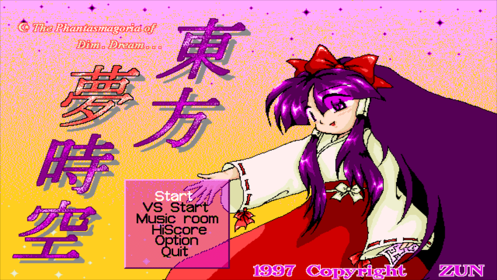
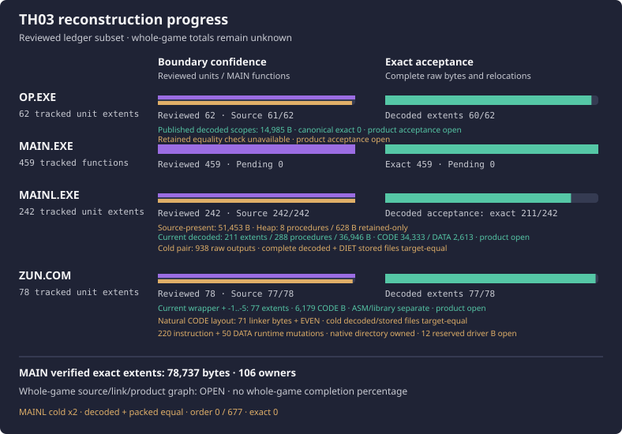

# 東方夢時空 ～ Phantasmagoria of Dim.Dream

<p align="center">
  
</p>

<p align="center">
  
</p>

This repository reconstructs the original Japanese PC-98 **Touhou 3:
Phantasmagoria of Dim.Dream**. It preserves maintained source and reviewed
findings for `MAIN.EXE`, `OP.EXE`, `MAINL.EXE` and `ZUN.COM`. The complete game
reconstruction is still in progress.

MAIN currently records **423 exact functions / 69,518 exact owned bytes** in
**92 exact CODE extents**. The current mixed build reproduces all **92 accepted
extents / 69,518 bytes** and their scoped ordered relocations. The C++ `main`, Chiyuri/Ellen,
lose update/particles/banners, next-round/score-commit and stage/round setup pass independent source cold
builds and the full required unit Oracle set. These are reviewed source scopes,
not a whole-game completion percentage. See [the progress table](docs/PROGRESS.md) and
[current handoff](docs/RE_HANDOFF.md) for the current acceptance state.

The current MAIN builder regenerates all **92 game objects** with the pinned
native tools, retaining the vendor startup and libraries. Repeated builds
produce identical raw objects, executable and MAP from two isolated source trees.
Ellen's native producer now emits the correct relocation order without OMF record rewriting; HUD intro
and the lose update, particles and banners also compile from maintained source.
The two real demo callbacks, stage setup and round initialization form one
1,865-byte native producer. Its 27 literal ordered relocations and all raw bytes
match; compiler tables and near return boundaries are reviewed separately.
The complete product still has three loaded-image byte differences and global
relocation-order differences.
OP, MAINL and ZUN have maintained source too; their product acceptance remains
separate from MAIN's reviewed CODE counts.

## Current products and navigation

| Product | Purpose | Maintained source |
| --- | --- | --- |
| `OP.EXE` | Menu and title flow | [`src/op/`](src/op/) |
| `MAIN.EXE` | Main game | [`src/main/`](src/main/) |
| `MAINL.EXE` | Ending | [`src/mainl/`](src/mainl/) |
| `ZUN.COM` | Launcher | [`src/zun/`](src/zun/) |

- [Current handoff and next reconstruction work](docs/RE_HANDOFF.md).
- [Progress and exact ownership counts](docs/PROGRESS.md).
- [Product architecture, source layout and local tools](docs/ARCHITECTURE.md).
- [Reconstruction workflow](docs/RE_WORKFLOW.md) and
  [required Oracle gates](config/oracles.toml).
- [Pinned Japanese targets](config/targets.toml),
  [compiler tools](config/toolchain.toml) and
  [Ghidra/JDK installation](config/analysis_toolchain.toml).
- [Script purposes and entry points](scripts/README.md).
- [Unit ledger](config/units.csv), [evidence](config/evidence.csv),
  [hypotheses](config/hypotheses.csv) and [current knowledge](config/knowledge.csv).

## Build and validate

With your local inputs and installed tools available:

```sh
python3 -m venv .venv
. .venv/bin/activate
python3 -m pip install --no-cache-dir -r requirements-ci.txt
python3 scripts/preflight.py
python3 scripts/replay_th03_main_native.py
python3 scripts/status.py
python3 scripts/ci.py
git diff --check
```

Use the same activated Python environment for verification. CI requires the
pinned public decoder/emulator dependencies in `requirements-ci.txt`;
GitHub Actions installs the same requirements file.

The MAIN command performs two independent cold builds of 93 native phases
each, compiling or assembling every game object before linking. All 94 raw
OBJ/EXE/MAP outputs must repeat before the scoped owner review can pass. It checks
complete owned bytes, MAP contributions, ordered MZ relocations and unchanged
native outputs. Its runtime checks compare
entry behavior and the recovered lose routines against the target. CI also
checks the slot initializer's pointer writes, memory preservation and far ABI.

The current build uses `.analysis/toolchain/wineprefix/drive_c/TH03WORK`.
The root assembly, existing score-entry alias, link configuration and bitmap
assembly are regenerated from the pinned reference and maintained source recipe.
Each cold round stages an empty source tree before replacing the previous work
tree; no saved source carrier or game object is required. Vendor startup and
libraries remain separate, and bounded unit exactness does not establish whole
product exactness.

Run one Borland/Wine writer at a time. Keep compiler/analyzer invocations
headless, use one available CPU at low priority, and preserve the game-local
Wine prefix. Current reports are overwritten in `.analysis/work/`. Old
validation outputs, installer downloads, logs and experiments can be deleted;
future verification can regenerate them.

## Setup

The tools follow [TH04's reconstruction workflow](https://github.com/N0zoM1z0/th04):
pinned Turbo C++ 4.0J, TASM32 and TLINK via Wine/MS-DOS Player, plus pinned
Ghidra and a headless JDK. TH03 has independent Wine state and analyzer projects.
The manifests above identify the actual installed versions and file hashes.

For a fresh installation:

```sh
mkdir -p _reference
git clone https://github.com/nmlgc/ReC98.git _reference/ReC98
git -C _reference/ReC98 checkout --detach b6ba5b0a529edbb31efdf8c0e939263804f8ee47
python3 scripts/import_targets.py /path/to/your/legal-copy.rar \
  --include-all-games-smoke --retain-runtime-image
DISPLAY= WAYLAND_DISPLAY= bash scripts/bootstrap_toolchain.sh
DISPLAY= WAYLAND_DISPLAY= bash scripts/bootstrap_analysis_toolchain.sh
python3 scripts/preflight.py
```

Host tools include Python 3, a C compiler, Wine, archive utilities and mtools.
Bootstrap verifies downloaded packages before installation. Routine checks verify the
installed tools, so the downloaded archives need not remain on disk. An
existing installation can use its current prefix and tools directly.

ReC98 supplies a pinned source/build scaffold. Its source is reference material;
TH03's maintained ownership and exactness are checked against TH03's own targets.
Product dependencies use local headers or explicit `compat/rec98/` forwarding.

Ghidra projects live under ignored `ghidra-project/`. Import a new MAIN database
or re-attest an existing one with the headless commands:

```sh
DISPLAY= WAYLAND_DISPLAY= python3 scripts/ghidra.py th03-main import
DISPLAY= WAYLAND_DISPLAY= python3 scripts/ghidra.py th03-main check
```

Before relying on database observations, run the check command. Analyzer
function boundaries and decompiler output remain provisional. See
[the workflow](docs/RE_WORKFLOW.md) for bounded Java heap/CPU settings.

## Local inputs

Supply your own legal copy. The importer selects the Japanese `zun.hdi` and
requires these artifacts:

| Artifact | Size | SHA-256 |
| --- | ---: | --- |
| `OP.EXE` | 36,041 | `d7bfa7f1f8afe0943763ce76437d12ed412b8452716dd64f937c94796eba57ab` |
| `MAIN.EXE` | 130,882 | `f41fde47ea36bf4d985ff9127b67fe93d5ecb58cc36e7cffab86959db7f2ce6b` |
| `MAINL.EXE` | 37,975 | `5b613023b4ae021794ff778871a732e7af0d0457ccdb3613e3458f2a609e466c` |
| `ZUN.COM` | 16,242 | `5896bbd673aeb10f0df9c1e34716c64fda83655a788ae1ac0fcf58e3616add27` |

These hashes have `candidate-local-attested` provenance: they identify the
supplied Japanese image while independent pristine-dump confirmation remains
open. That qualification is separate from reconstruction of the pinned bytes.
Original executables, disk images, private tools and game data are excluded
from Git. The title image above is the supplied original screenshot.

## Source and validation

Source belongs under `src/main/`, `src/op/`, `src/mainl/`, `src/zun/` and
`src/shared/`, organized by subsystem. MAINL is TH03's ending executable.
`.c`, `.cpp` and `.asm` files are translation units; `.inl` files are bounded
includes. See [the architecture](docs/ARCHITECTURE.md) and
[reconstruction workflow](docs/RE_WORKFLOW.md).

Exact acceptance requires complete raw-byte equality, literal ordered
relocations, reviewed ownership and ABI/layout, affected behavior and independent
cold reproducibility. Compiler success, decompiler output or a reference-game
build alone does not establish exactness. Useful findings belong in source,
ledgers and the concise handoff; keeping old verification directories is optional.

Portable CI checks ledgers and positive/negative Oracle controls without
proprietary inputs. Available private inputs additionally enable real target,
compiler and analyzer checks. Finish with:

```sh
python3 scripts/ci.py
git diff --check
```

Commit format: `gpt-6.1-sol: xxx`.

## Credits

- [Our TH04 reconstruction repository](https://github.com/N0zoM1z0/th04)
  provides the reference workflow, directory organization, headless compiler
  and analyzer setup, and cold-build exact Oracle approach used by this project.
- [ReC98 by Nmlgc and contributors](https://github.com/nmlgc/ReC98)
  provides foundational PC-98 Touhou reverse-engineering work and the pinned
  source/build scaffold used in our compiler and full cold-build comparisons.

TH03's maintained sources and exact ownership are checked independently against
its original Japanese targets. Referenced work retains its own authorship and
licensing.

## License

Repository-authored code and documentation are provided under the MIT License.
This does not grant rights to the original game, its assets, or referenced
third-party work.
