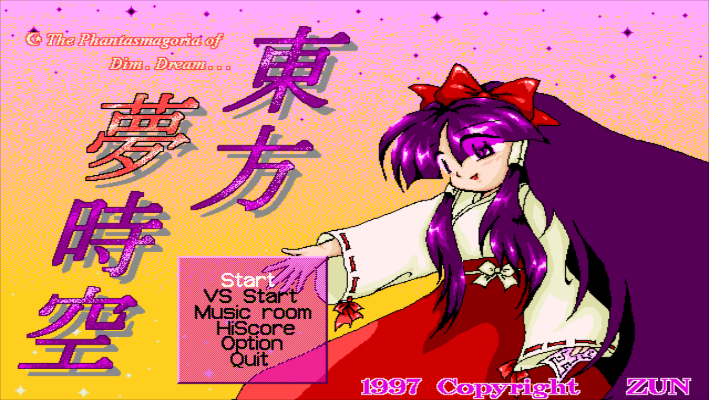
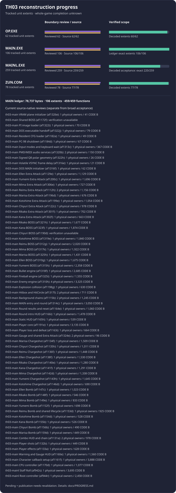

# 東方夢時空 ～ Phantasmagoria of Dim.Dream

<p align="center">
  
</p>
<p align="center">
  
</p>

This repository reconstructs the original Japanese PC-98 **Touhou 3:
Phantasmagoria of Dim.Dream**. Work covers OP.EXE, MAIN.EXE, MAINL.EXE (the ending)
and ZUN.COM. Reconstruction and whole-product source acceptance remain open.

[Generated progress](docs/PROGRESS.md) distinguishes canonical packed-unit acceptance from reviewed decoded source and historical source-native build evidence. The historical after587 MAINL native link reproduced the decoded Japanese ending EXE and MAP, but its **live source-bound decoded publication remains pending** after later source changes invalidated an old input guard. That historic result does not grant current or canonical packed-file acceptance. See the [current handoff](docs/RE_HANDOFF.md) for the precise scope and outstanding work.
[The handoff](docs/RE_HANDOFF.md) records the latest verified checkpoint,
remaining work, local state and findings for the next agent. Source-present,
bounded exact source scopes and target-equal complete builds are separate claims;
there is no whole-game completion percentage.

## Navigation

| Area | Entry point |
| --- | --- |
| Product source | [MAIN](src/main/), [OP](src/op/), [MAINL](src/mainl/), [ZUN](src/zun/), [proved shared code](src/shared/) |
| Start/resume work | [AGENTS.md](AGENTS.md), [handoff](docs/RE_HANDOFF.md), [workflow](docs/RE_WORKFLOW.md) |
| Source/build/evidence organization | [Architecture](docs/ARCHITECTURE.md), [script index](scripts/README.md) |
| Acceptance and findings | [Units](config/units.csv), [evidence](config/evidence.csv), [knowledge](config/knowledge.csv), [Oracle gates](config/oracles.toml) |
| Pinned inputs/tools | [Japanese targets](config/targets.toml), [DIET identities](config/th03_diet.toml), [native tools](config/toolchain.toml), [Ghidra/JDK](config/analysis_toolchain.toml) |

## Validate an existing checkout

Use the existing `.venv`, installed tools and game-local Wine prefix.

```sh
.venv/bin/python scripts/preflight.py
.venv/bin/python scripts/status.py
git diff --check
```

Choose one CPU allowed by `os.sched_getaffinity(0)`; do not assume a fixed host
CPU number. Serialize Borland/Wine writers. The [workflow](docs/RE_WORKFLOW.md) lists
affected cold/review/publication commands. Check the changed native scope and
reuse an unchanged cold pair. Full `scripts/ci.py` is available for broad
infrastructure changes; it is not a routine per-unit requirement. Re-attest a
Ghidra database before using its observations.

## Fresh installation

Supply your own legal Japanese copy. Targets, disk images, private tools and
assets stay outside Git. Pinned hashes have **candidate-local-attested** provenance;
independent pristine-dump confirmation remains unknown.

```sh
python3 -m venv .venv
.venv/bin/python -m pip install --no-cache-dir -r requirements-ci.txt
mkdir -p _reference
git clone https://github.com/nmlgc/ReC98.git _reference/ReC98
git -C _reference/ReC98 checkout --detach b6ba5b0a529edbb31efdf8c0e939263804f8ee47
.venv/bin/python scripts/import_targets.py /path/to/your/legal-copy.rar \
  --include-all-games-smoke --retain-runtime-image
DISPLAY= WAYLAND_DISPLAY= bash scripts/bootstrap_toolchain.sh
DISPLAY= WAYLAND_DISPLAY= bash scripts/bootstrap_analysis_toolchain.sh
.venv/bin/python scripts/preflight.py
```

Host dependencies include Python 3, a C compiler, Wine, archive utilities and
mtools. Bootstrap verifies downloaded packages; manifests identify the exact
installed versions. Use `.venv/bin/python` consistently for Capstone/Unicorn.
The bounded ZUN emitter is installed through `scripts/bootstrap_jwasm.py`.

## Maintenance and handing off

The [current, concise handoff](docs/RE_HANDOFF.md) begins with the
after730 **six-physical-source simultaneous** native checkpoint,
including the newly direct source-bound sound and polar/CFG helper owners,
and separately preserves the after724 seven-source BOSS/intro/Bullet/HUD
proof, after721/715 integrations and historical after709 58-owner union.
It retains after596 MAIN and historical after587 MAINL as *different*
source-native ancestors, not current
whole-game acceptance. The [after709 chronological archive](docs/RE_HANDOFF_ARCHIVE_AFTER709.md)
and [earlier after596 archive](docs/RE_HANDOFF_ARCHIVE_AFTER596.md)
preserve the detailed experiments, negative trials and limitations.

MAIN's frozen after596 normal source-native link, and the later
after730 six-object current-source overlay, reproduce the complete
124,642-byte Japanese loaded program and all 1,553 ordered MZ relocations.
A **separate standard DOS MZ serializer** then reproduces the entire
original 130,882-byte Japanese MAIN.EXE; this does not prove that the
historic compiler/linker used the same header format. The historical after587 MAINL
source-native link reproduced the entire 67,372-byte decoded Japanese
MAINL EXE and all 677 ordered relocations. Neither establishes
canonical packed-file Factory acceptance or complete historical source
ownership. MAINL's historical after587 decoded publication reviewed 220
extents / 37,968 bytes, but the live decoded source gate is **pending**
after later MAIN source edits invalidated an older broad source-snapshot
guard. Its formal packed-unit credit remains 0/250; see the handoff
for the unchanged historical linker evidence and recertification blocker.

To verify this checkout without replaying unchanged source or toolchains:

    git status -sb
    DISPLAY= WAYLAND_DISPLAY= PYTHONPATH=scripts .venv/bin/python scripts/review_th03_main_source_overlay.py --stage af730a
    DISPLAY= WAYLAND_DISPLAY= PYTHONPATH=scripts .venv/bin/python scripts/review_th03_main_source_overlay.py --stage af724a
    DISPLAY= WAYLAND_DISPLAY= PYTHONPATH=scripts .venv/bin/python scripts/review_th03_main_source_overlay.py --stage af721a
    DISPLAY= WAYLAND_DISPLAY= PYTHONPATH=scripts .venv/bin/python scripts/review_th03_main_source_overlay.py --stage af715a
    DISPLAY= WAYLAND_DISPLAY= PYTHONPATH=scripts .venv/bin/python scripts/review_th03_main_source_overlay.py --stage af709a
    DISPLAY= WAYLAND_DISPLAY= PYTHONPATH=scripts .venv/bin/python scripts/review_th03_main_yumemi_cpu_after596_work.py
    DISPLAY= WAYLAND_DISPLAY= PYTHONPATH=scripts .venv/bin/python scripts/review_th03_mainl_score_input_pi_after587_work.py
    .venv/bin/python scripts/progress.py --check
    .venv/bin/python scripts/validate_tracking.py
    git diff --check

The [storage handoff](docs/STORAGE_HANDOFF_CURRENT.md) distinguishes
the historical applied after520 deletion audit (258 stages / 5,760
protected native files) from current retained evidence, and records
subsequent **audited disposable-only maintenance**. Do not apply the
old cleanup script to a newer source graph or delete full old
compiler stages by age. Cache-only cleanup is separate from original
evidence retention; preserve Japanese targets, installed Wine/Borland
tools, source root, native OBJ/EXE/MAP, both rounds, scripts/receipts
and writer logs. Prefer changed-scope validation, not full cold replay.

Historical details: [after554 handoff archive](docs/RE_HANDOFF_ARCHIVE_AFTER554.md),
[after520 storage record](docs/STORAGE_HANDOFF_AFTER520.md) and
[CRT recovery index](docs/MAINL_WORKING_CRT_RECOVERY_INDEX.md).

## Credits

- [Our TH04 reconstruction repository](https://github.com/N0zoM1z0/th04)
  provides the reference workflow, directory organization, headless tool setup
  and cold-build exact Oracle approach.
- [ReC98 by Nmlgc and contributors](https://github.com/nmlgc/ReC98)
  provides foundational PC-98 Touhou reverse engineering and the pinned scaffold.

TH03's maintained ownership and exactness are checked against its own Japanese
targets. Referenced work retains its authorship and licensing.
